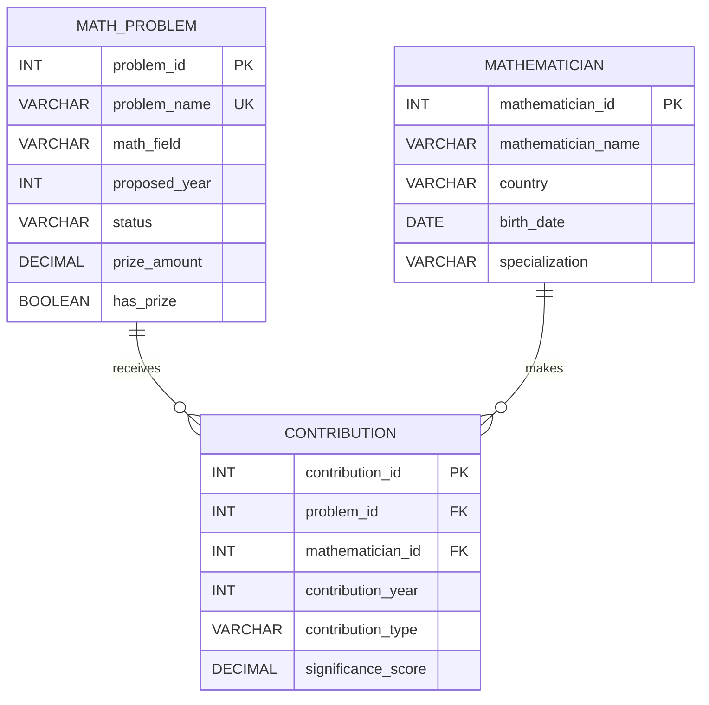

# MathMyst

**Exploring the Mysteries of Mathematics**
*Where Mathematical Mysteries Meet Database Intelligence.*

GitHub repository: [tanveerk24/MathMyst](https://github.com/tanveerk24/MathMyst).

The local project is complete and verified. The initial push was rejected because
the available GitHub account lacks access; see the [publication status and exact retry commands](docs/github_publish.md).

MathMyst is a local Flask and MySQL/MariaDB application for exploring mathematical problems, mathematicians, and their research contributions. It combines a research catalogue with a database dashboard and an educational SQL query laboratory.

This project is designed for a third-year Computer Science DBMS laboratory examination. The code uses explicit SQL and three related entities so that the database design and query behavior remain easy to inspect and explain.

## Problem statement and objectives

Information about mathematical problems and the people who study them is often scattered across separate sources. MathMyst demonstrates how a relational database can organize those records, connect researchers with problems, enforce valid relationships, and answer analytical questions.

The objectives are to design a normalized relational model, implement validated CRUD operations, demonstrate joins and aggregation, and explain database concepts through executable examples. The historical seed records are illustrative selections rather than a complete research bibliography; sources and editorial choices are documented in [data_sources.md](docs/data_sources.md).

## Features

- A mathematics-themed, responsive home page.
- Database-derived dashboard totals and charts.
- Problem search, field/status filters, year sorting, and create/edit/delete forms.
- Mathematician search and links to associated contributions.
- Contribution forms with database-populated foreign-key dropdowns.
- A query laboratory containing 34 developer-approved, read-only SQL queries, with SQL text, concepts, explanations, and result tables.
- Validation, CSRF protection, parameterized SQL, friendly error pages, and transaction handling.
- Separate SQL scripts for schema, sample data, views, procedures, triggers, and exam practice.
- Automated unit and opt-in database integration tests.
- An ER diagram, database design notes, and 70 viva questions.

The application has no authentication and is intended for trusted local demonstrations. Run it on `127.0.0.1`; unrestricted CRUD access must not be exposed publicly.

## Technology stack

| Layer | Technology | Purpose |
| --- | --- | --- |
| Interface | HTML5, CSS3, vanilla JavaScript | Responsive forms, tables, navigation, and interactions |
| Templates | Jinja2 | Shared layouts and dynamic records |
| Backend | Python 3, Flask 3 | Routes, validation, request handling |
| Database driver | PyMySQL | Parameterized SQL and transactions |
| Database | MySQL 8.0.16+ or MariaDB 10.4+ with InnoDB | Constraints, relationships, queries |
| Configuration | python-dotenv | Environment-based configuration |
| Testing | pytest | Unit and database integration tests |
| Charts | Chart.js from a CDN | Dashboard visualizations; tables remain usable without it |
| Version control | Git and GitHub | Source history and sharing |

An older MySQL server can silently ignore `CHECK` constraints. Use the documented minimum version or later, rather than relying on MySQL 5.7. See the [MySQL CHECK reference](https://dev.mysql.com/doc/refman/8.0/en/create-table-check-constraints.html).

## Database entities and relationships

| Entity | Primary key | Purpose |
| --- | --- | --- |
| `MATH_PROBLEM` | `problem_id` | Problem name, field, proposed year, status, and prize information |
| `MATHEMATICIAN` | `mathematician_id` | Name, country, birth date, and specialization |
| `CONTRIBUTION` | `contribution_id` | A research event connecting one mathematician to one problem |

Each problem can have zero or many contributions, and each mathematician can have zero or many contributions. Each contribution must reference exactly one existing problem and one existing mathematician. This resolves the many-to-many relationship between problems and mathematicians.



Both foreign keys use `ON DELETE RESTRICT` and `ON UPDATE CASCADE`. Delete related contributions before deleting a referenced parent. The full [database design](docs/database_design.md) explains keys, nullability, normalization, and design limitations.

## Project structure

```text
MathMyst/
  app.py                    Flask application factory and local entry point
  config.py                 Environment configuration
  db.py                     Connections and SQL helpers
  query_catalog.py          Approved query definitions
  requirements.txt
  .env.example
  database/                 Schema, seed data, and SQL demonstrations
  routes/                   Flask Blueprints
  templates/                Jinja2 HTML pages
  static/css/style.css
  static/js/main.js
  docs/                     Design, sources, SQL explanations, and viva preparation
  tests/                    Automated tests
```

## Installation on Windows PowerShell

### 1. Prerequisites

Install Python 3, Git, and either MySQL or MariaDB. XAMPP's MariaDB is also suitable when its version meets the requirement. Start the MySQL/MariaDB service or click **Start** beside MySQL in the XAMPP control panel.

Open PowerShell in the project directory. For the workspace used to create this project:

```powershell
Set-Location 'C:\Users\Tanveer\OneDrive\Desktop\dbms project\MathMyst'
python --version
python -m venv .venv
.\.venv\Scripts\python.exe -m pip install --upgrade pip
.\.venv\Scripts\python.exe -m pip install -r requirements.txt
```

For a fresh checkout elsewhere, clone the confirmed repository and enter its directory first:

```powershell
git clone https://github.com/tanveerk24/MathMyst.git
Set-Location .\MathMyst
```

These commands call the virtual environment's Python directly, so changing PowerShell's execution policy or activating a script is unnecessary.

### 2. Create the database and load sample data

Open the database client as an administrator. `-p` prompts for the password without putting it in command history:

```powershell
mysql -u root -p
```

If XAMPP is installed and `mysql` is absent from `PATH`, use:

```powershell
& 'C:\xampp\mysql\bin\mysql.exe' -u root -p
```

Inside the `mysql>` client, run the following, adjusting the paths if you moved the project. `SOURCE` paths use forward slashes and are entered in the database client, not PowerShell:

```sql
SOURCE C:/Users/Tanveer/OneDrive/Desktop/dbms project/MathMyst/database/schema.sql;
SOURCE C:/Users/Tanveer/OneDrive/Desktop/dbms project/MathMyst/database/seed.sql;
USE MathMyst;
SHOW TABLES;
SELECT COUNT(*) AS problems FROM MATH_PROBLEM;
SELECT COUNT(*) AS mathematicians FROM MATHEMATICIAN;
SELECT COUNT(*) AS contributions FROM CONTRIBUTION;
```

Load `seed.sql` only into a new, empty database. It is sample initialization, not a migration tool; do not use it to overwrite edited records. `schema.sql` does not intentionally drop the application tables. Back up any database containing your own data before manual changes.

### 3. Create a dedicated application user

While still using the administrator connection, replace the placeholder below with your own password:

```sql
CREATE USER 'mathmyst_user'@'localhost' IDENTIFIED BY 'replace_with_your_own_password';
GRANT SELECT, INSERT, UPDATE, DELETE ON MathMyst.* TO 'mathmyst_user'@'localhost';
SHOW GRANTS FOR 'mathmyst_user'@'localhost';
EXIT;
```

The application does not need `CREATE`, `ALTER`, `DROP`, `TRIGGER`, or administrator permissions. Create optional database objects with an administrator connection. The localhost account matches the documented local setup; if your server distinguishes connection hosts, create/grant the account for the actual local host reported by the server.

### 4. Configure environment variables

```powershell
Copy-Item .env.example .env
.\.venv\Scripts\python.exe -c "import secrets; print(secrets.token_hex(32))"
notepad .env
```

Set the database password and paste the generated value as `FLASK_SECRET_KEY`:

```dotenv
DB_HOST=localhost
DB_PORT=3306
DB_USER=mathmyst_user
DB_PASSWORD=replace_with_your_own_password
DB_NAME=MathMyst
FLASK_SECRET_KEY=replace_with_the_generated_random_value
```

Do not copy example credentials unchanged, commit `.env`, or use the root account for ordinary application requests. `.env.example` contains placeholders and is safe to share.

### 5. Run MathMyst

```powershell
.\.venv\Scripts\python.exe app.py
```

Open **http://127.0.0.1:5000**. Keep PowerShell open while demonstrating the app. Press **Ctrl+C** to stop it. Flask debug mode is disabled by default.

If a database-backed page reports that the database is unavailable, check that the server is running, the schema/seed scripts completed, the dedicated user's grants are correct, and `.env` matches those credentials. The home page can introduce the project before a connection is configured.

For the private port-3307 MariaDB instance already initialized in this particular workspace, see [local verification setup](docs/local_verification.md). Its ignored datadir and credentials are not included in a GitHub clone.

## SQL query laboratory

Choose a query in **SQL Query Lab** to see its statement, concept, explanation, and database result. The server looks up a fixed query identifier; it does not accept arbitrary SQL text. All laboratory statements are approved `SELECT` queries. Database modifications belong to validated CRUD forms.

Example: find problems without any recorded contributions:

```sql
SELECT p.problem_name
FROM MATH_PROBLEM AS p
LEFT JOIN CONTRIBUTION AS c ON c.problem_id = p.problem_id
WHERE c.contribution_id IS NULL;
```

Example: count recorded contributions for each problem, including zero:

```sql
SELECT p.problem_name, COUNT(c.contribution_id) AS contribution_count
FROM MATH_PROBLEM AS p
LEFT JOIN CONTRIBUTION AS c ON c.problem_id = p.problem_id
GROUP BY p.problem_id, p.problem_name
ORDER BY contribution_count DESC, p.problem_name;
```

Example: find problems whose recorded prize exceeds the mean:

```sql
SELECT problem_name, prize_amount
FROM MATH_PROBLEM
WHERE prize_amount > (SELECT AVG(prize_amount) FROM MATH_PROBLEM);
```

The application catalogue is defined in `query_catalog.py`; `database/queries.sql` provides the corresponding examination queries. See [SQL explanations](docs/sql_explanations.md) for joins, grouping, subqueries, and common pitfalls.

## Optional database demonstrations

These files are for a database administrator using the MySQL/MariaDB client; they are not automatically executed by the web app:

| File | Purpose |
| --- | --- |
| `database/views.sql` | Reusable query views |
| `database/procedures.sql` | Simple stored procedure examples |
| `database/triggers.sql` | Trigger examples without adding an audit entity |
| `database/exam_practice.sql` | DDL/DML and transaction practice with a disposable demonstration table |

Read each script before executing it. Use a disposable practice database for manual experiments. MySQL DDL such as `CREATE TABLE`, `ALTER TABLE`, `DROP TABLE`, and creation of views, procedures, and triggers causes implicit commits; wrapping it in a transaction does not make it safely reversible. The modifying exercises are separated from the read-only laboratory. See [MySQL's implicit-commit documentation](https://dev.mysql.com/doc/refman/8.0/en/implicit-commit.html).

To install the optional objects, open an administrator client as above and run:

```sql
SOURCE C:/Users/Tanveer/OneDrive/Desktop/dbms project/MathMyst/database/views.sql;
SOURCE C:/Users/Tanveer/OneDrive/Desktop/dbms project/MathMyst/database/procedures.sql;
SOURCE C:/Users/Tanveer/OneDrive/Desktop/dbms project/MathMyst/database/triggers.sql;
SELECT * FROM MathMyst.problem_summary;
SELECT * FROM MathMyst.contribution_details;
CALL MathMyst.GetProblemContributions(7);
```

The views are `problem_summary` and `contribution_details`. `GetProblemContributions` is a read-only procedure parameterized by problem ID. The optional insert/update triggers reject out-of-range contribution scores, repeating the check constraint for teaching. The procedure and trigger scripts replace objects with the same demonstration names. `exam_practice.sql` creates and drops a connection-local temporary table, demonstrates application DML inside a rolled-back transaction, and commits a no-op update. Run it only after reading its comments; it does not add a persistent fourth entity.

## Testing

Run the tests that do not require a running database:

```powershell
.\.venv\Scripts\python.exe -m pytest -q
```

Database integration tests are opt-in and must use a separate test database. They are never intended for the main `MathMyst` database. Follow the test fixture's guardrails and use a dedicated test account. A typical test configuration is:

First create the dedicated schema and account in an administrator database client. This account's extra privileges are limited to the disposable test schema:

```sql
CREATE DATABASE IF NOT EXISTS mathmyst_test CHARACTER SET utf8mb4 COLLATE utf8mb4_unicode_ci;
CREATE USER 'mathmyst_test_user'@'localhost' IDENTIFIED BY 'replace_with_your_test_password';
GRANT ALL PRIVILEGES ON mathmyst_test.* TO 'mathmyst_test_user'@'localhost';
```

Then run in PowerShell:

```powershell
$env:TEST_DB_HOST = 'localhost'
$env:TEST_DB_PORT = '3306'
$env:TEST_DB_NAME = 'mathmyst_test'
$env:TEST_DB_USER = 'mathmyst_test_user'
$env:TEST_DB_PASSWORD = 'your_test_user_password'
.\.venv\Scripts\python.exe -m pytest --integration -q
```

The test schema name must be exactly `mathmyst_test` and must differ from the configured main `DB_NAME`. The test account needs permissions only on this schema, including the table creation and cleanup permissions used by the fixtures. Set up this separate account/schema as an administrator rather than expanding the application account's privileges. Consult `tests/conftest.py` for the exact integration setup before running it.

A passing unit suite is not evidence that a particular MySQL installation is configured correctly. Integration tests verify the real engine's constraints and relationships when a test server is available. Test output must be checked for failures and skips; skipped tests are unverified.

### Verification performed

On **6 November 2026**, the full opt-in run against the isolated **MariaDB 10.4.32** test database completed with **140 passed in 7.78 seconds, with no skipped tests**. This verifies the real MariaDB engine rather than only mocked connections. The default test command intentionally skips integration tests unless `--integration` is selected. MySQL 8 was not separately executed in this environment, so compatibility with that engine is not an independently verified test result.

The five optional SQL demonstration scripts also executed successfully against the isolated test database. Their result counts, trigger rejection checks, and before/after data comparison are documented in [SQL verification](docs/sql_verification.md).

## Five-minute examination demonstration

1. Introduce the three entities using the ER diagram and explain why `CONTRIBUTION` resolves a many-to-many relationship.
2. Open the dashboard and relate its counts to `COUNT`, `GROUP BY`, and the underlying records.
3. Filter unsolved number-theory problems; explain the parameterized `WHERE` conditions.
4. Add a temporary mathematician and problem, then connect them through a contribution. Edit the contribution score.
5. Try deleting the referenced problem to demonstrate `RESTRICT`. Delete the contribution first, then remove the temporary parents.
6. Run an `INNER JOIN`, a `LEFT JOIN` showing missing relationships, a `HAVING` query, and a subquery in the laboratory.
7. Explain transaction commit/rollback, CSRF protection, and the difference between Python validation and database constraints.

## DBMS concepts demonstrated

The repository covers DDL, DML, DQL; primary/foreign/unique keys; `NOT NULL`, defaults, and checks; filtering and sorting; aggregates; grouping and `HAVING`; inner/left/right/self joins; scalar, `IN`, and correlated subqueries; `EXISTS` and `NOT EXISTS`; indexes; views; procedures; triggers; and InnoDB transactions with `COMMIT` and `ROLLBACK`.

## Git and GitHub

Before committing, run the tests and inspect staged files. `.env`, virtual environments, Python caches, and local database dumps must stay untracked.

```powershell
git status
git diff --check
git add .
git diff --cached --name-only
git diff --cached
git commit -m "Build MathMyst DBMS application and examination resources"
```

If Git is installed at the standard Windows location but is absent from `PATH`, open Git Bash or temporarily add its executable directory in the current PowerShell session:

```powershell
$env:Path = 'C:\Program Files\Git\cmd;' + $env:Path
git --version
```

Use a repository that you own or are authorized to update. Inspect an existing remote before any push:

```powershell
git remote -v
git branch --show-current
```

If there is no remote, obtain your intended GitHub repository URL first. After creating an empty GitHub repository, replace `YOUR_OWNER` with your account or organization:

```powershell
git remote add origin https://github.com/YOUR_OWNER/MathMyst.git
git push -u origin HEAD
```

Do not configure a guessed URL or force-push. If the remote already contains commits, fetch and inspect its history before integrating changes. For authentication, install GitHub CLI and run `gh auth login`, or sign in to GitHub using VS Code's Accounts menu and Git credential support. Passwords or access tokens must never be embedded in the remote URL.

## Documentation and screenshots

- [Project description](docs/project_description.md)
- [Database design](docs/database_design.md)
- [ER diagram](docs/er_diagram.md)
- [Historical data sources](docs/data_sources.md)
- [SQL explanations](docs/sql_explanations.md)
- [Viva preparation](docs/viva_questions.md)
- [This workspace's optional private database](docs/local_verification.md)
- [Executed SQL verification](docs/sql_verification.md)

These screenshots were captured from the running application backed by the local MariaDB database:

- [Home overview](docs/screenshots/overview.png)
- [Database dashboard](docs/screenshots/dashboard.png)
- [SQL query laboratory](docs/screenshots/query-lab.png)
- [Mobile layout](docs/screenshots/mobile.png)

## Limitations and future improvements

The three-entity model intentionally omits papers, citations as structured records, researcher accounts, collaborative author lists, and detailed problem descriptions. Country and specialization are simplified single-valued attributes. Significance scores are editorial demonstration values, not established rankings. A prize amount describes the catalogue's recorded prize; it does not prove that an award is currently available or was accepted.

Future work could add authenticated administration, pagination, bibliographic provenance fields, migrations, and richer accessibility checks. Any expansion beyond three main entities should be discussed separately from this examination version.

## Academic purpose and license

Use this project to understand and explain the SQL, relationships, and application flow. Verify historical sources before presenting research claims and follow your institution's academic integrity rules. The source code is available under the [MIT License](LICENSE); linked historical sources retain their own terms.
