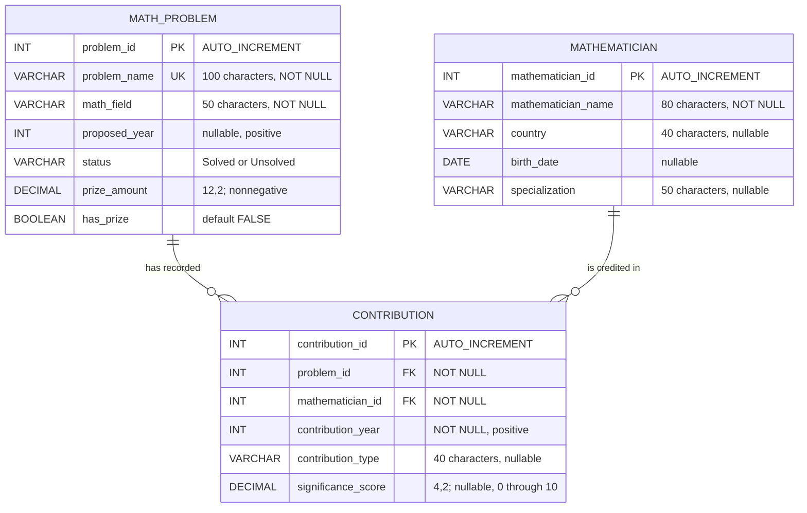

# MathMyst entity relationship diagram

The `||` end means exactly one parent, and the `o{` end means zero or many children. Thus, every contribution belongs to one existing problem and one existing mathematician. A problem or mathematician may exist without a contribution.

`MATH_PROBLEM` and `MATHEMATICIAN` have a many-to-many relationship through `CONTRIBUTION`. For example, several mathematicians may contribute to one problem, and one mathematician may contribute to several problems. The contribution table also stores facts about the association: year, contribution type, and significance score.

Both foreign keys use `ON DELETE RESTRICT`: a referenced parent cannot be removed while its contributions remain. Both use `ON UPDATE CASCADE`: if a referenced key is changed directly in SQL, the related foreign-key values follow it. The web forms do not edit primary keys.

Exactly three main application entities are present. Views are saved query definitions rather than additional application entities. Any disposable table used for DDL practice is separate from the application model and must be removed after the exercise.
