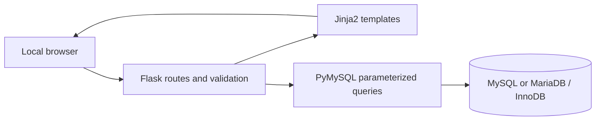

# MathMyst: project description

## Overview

MathMyst is an educational relational database application about famous mathematical problems and the mathematicians who contributed to their study. Its tagline is **Where Mathematical Mysteries Meet Database Intelligence.**

It provides a catalogue, CRUD forms, a database-derived dashboard, and a predefined SQL laboratory. The application is intended for a trusted local DBMS laboratory demonstration, with explicit SQL that a student can read and defend during a viva.

## Problem statement

A list of problems alone cannot answer which researchers worked on a problem, which problems share a researcher, or which catalogue entries have no recorded contributions. A single spreadsheet also repeats names and problem details whenever a new contribution is added. MathMyst separates those facts into three relations and connects them through foreign keys.

## Objectives

1. Design three related entities with clear primary and foreign keys.
2. Store reliable sample records without inventing historical associations.
3. Demonstrate validated create, read, update, and delete operations.
4. Use SQL joins, aggregates, grouping, and subqueries to answer meaningful questions.
5. Explain referential integrity and demonstrate a restricted parent deletion.
6. Keep installation, source code, and examination preparation approachable.

## Scope

The system stores mathematical problems, mathematicians, and individual contribution records. It supports searching problems and people, filtering relationships, editing records, inspecting dashboard statistics, and executing developer-approved read-only queries.

It does not evaluate mathematical proofs or determine whether a new proof is correct. It is not a comprehensive historical bibliography, a current prize registry, or a public multi-user research service. There is no authentication in this local version.

## Architecture

The presentation layer uses semantic HTML, CSS, JavaScript, and Jinja2. Flask routes receive requests, validate form fields, and call PyMySQL helpers. MySQL or MariaDB stores the three InnoDB tables and enforces their constraints.

Blueprints organize the problem, mathematician, contribution, dashboard, and query-laboratory routes. Connection helpers keep database access in one place. Environment variables supply credentials, while `.env.example` documents configuration without storing real secrets.

## Typical request flow

For a new contribution, the GET request loads existing problem and mathematician names into dropdowns. A POST submits their IDs, the year, type, score, and CSRF token. The server validates the token and values before executing a parameterized `INSERT`. The database checks the referenced parents and numeric constraints. A successful write commits and redirects with a success message; a failed write rolls back and displays an appropriate message.

## Integrity and security

The database is the final authority for key and check constraints. Python validation provides understandable field-level feedback. Parameters bind user values separately from SQL syntax; approved identifiers and sort expressions are selected from server-side allowlists. State changes use POST with CSRF protection. Credentials and SQL exception details are not displayed to users.

The laboratory accepts a known query ID rather than arbitrary SQL. The local app user receives only `SELECT`, `INSERT`, `UPDATE`, and `DELETE` on the application database. Administrator-only setup and demonstrations remain outside the public routes.

## Educational value

The project demonstrates how database rules and web validation complement each other. Its seed data includes unlinked parent records for outer joins and researchers with several contributions for grouping and subquery examples. The SQL scripts also show views, procedures, triggers, indexes, and transactions without adding unnecessary application entities.

## Evaluation and limitations

Automated tests cover application behavior and, when a separate test server is configured, real database behavior. Unit tests cannot verify an unavailable engine. Historical facts and seed sources are recorded in [data_sources.md](data_sources.md); subjective scores are explicitly distinguished from historical facts.

The supplied model is deliberately small. Collaborative research events may appear as separate per-researcher contribution rows, so counting contribution rows is not the same as counting unique papers or discoveries. Future versions could add provenance and collaboration modeling after the examination scope is complete.
